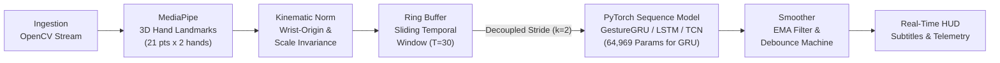

<div align="center">

  # Real-Time Sign Language Translator
  ### *Lightweight Dynamic Gesture Recognition & Translation Pipeline*

  <p align="center">
    <a href="https://python.org"></a>
    <a href="https://pytorch.org"></a>
    <a href="https://developers.google.com/mediapipe"></a>
    <a href="https://opencv.org"></a>
    <a href="https://opensource.org/licenses/MIT"></a>
  </p>

  <p align="center">
    <b>A modular computer vision and sequence-modeling system for dynamic sign language recognition on commodity CPU hardware, featuring wrist-anchored kinematic normalization, attention-augmented sequence models, and debounced real-time inference.</b>
  </p>

  <p align="center">
    <a href="#-system-architecture--data-flow">Architecture</a> •
    <a href="#-key-engineering-highlights">Engineering Highlights</a> •
    <a href="#-architecture-ablation--held-out-test-benchmarks">Benchmarks</a> •
    <a href="#-quickstart--installation">Quickstart</a> •
    <a href="#-limitations--error-analysis">Limitations</a>
  </p>

</div>

---

## 🏗️ System Architecture & Data Flow

Traditional video action recognition feeds high-dimensional RGB voxel cubes (e.g., $30\text{ frames} \times 640 \times 480 \times 3$) into large 3D-CNNs (I3D, SlowFast, Video-Swin), incurring heavy compute overhead on CPU.

This project decouples **spatio-temporal perception** into a two-stage landmark-to-sequence pipeline:



### Detailed Pipeline Breakdown

| Pipeline Stage | Module | Algorithmic Mechanism |
| :--- | :--- | :--- |
| **1. Video Capture** | [`inference.py`](./inference.py) | OpenCV stream ingestion, RGB color conversion, horizontal mirror flip for webcam interaction. |
| **2. Landmark Detection** | [`feature_extractor.py`](./feature_extractor.py) | MediaPipe Hand Landmarker (`Tasks API` with `mp.solutions` fallback), regressing 21 3D landmarks per hand. |
| **3. Kinematic Normalization** | [`feature_extractor.py`](./feature_extractor.py) | **Translation Centering:** $p'_i = p_i - p_0$<br>**Scale Normalization:** $p''_i = \frac{p'_i}{\|p'_9\|_2 + \epsilon}$ |
| **4. Temporal Windowing** | [`buffer.py`](./buffer.py) | Circular FIFO ring-buffer preserving continuous $T=30$ frame context with contiguous PyTorch tensor output. |
| **5. Sequence Inference** | [`models.py`](./models.py) | Unidirectional PyTorch **`GestureGRU`** (`bidirectional=False`, 64,969 params) with temporal self-attention pooling, plus `GestureLSTM` and `GestureTCN` variants. Evaluated on stride $k=2$. |
| **6. Temporal Debounce** | [`smoother.py`](./smoother.py) | Softmax EMA filter ($\alpha=0.65$), confidence threshold gate ($\tau=0.70$), and consecutive-frame debounce ($N=3$). |

---

## 🚀 Key Engineering Highlights

### Spatial Dimensionality Reduction
By extracting 3D hand coordinates rather than processing raw image pixels:
$$\text{Compression Factor} = \frac{640 \times 480 \times 3 \times 30 \text{ floats}}{30 \times (2 \times 21 \times 3) \text{ floats}} \approx \mathbf{7{,}314\times \text{ Data Reduction}}$$
This delegates visual hand-pose regression to MediaPipe while feeding a compact $126$-dimensional kinematic vector per frame into PyTorch.

### Scale & Translation Invariance
Sign language gestures must remain consistent regardless of signer position or camera depth:
1. **Wrist-Anchored Origin**: Sets wrist landmark index `0` to $(0, 0, 0)$, making spatial coordinates invariant to frame translation.
2. **Anthropometric Metric Scale**: Scales all vectors by the Euclidean distance from wrist (`0`) to middle finger MCP (`9`), rendering the representation invariant to camera depth and hand size.

### Attention-Augmented Dynamic Sequence Modeling
Static classifiers cannot distinguish dynamic trajectories (e.g., a stationary fist vs. a nodding "YES", or waving "HELLO").
- **`GestureGRU` (`bidirectional=False`, 64,969 params)**: Unidirectional 2-layer GRU with `LayerNorm` input projection and `TemporalAttention` pooling to weight key inflection frames across the 30-frame window.
- **`GestureLSTM` & `GestureTCN`**: Included as drop-in architectural baselines for controlled ablation studies, with `GestureTCN` using dilated 1D causal convolutions.

### Zero-Flicker Debounce State Machine
Direct frame-by-frame `argmax` predictions produce label flickering. [`PredictionSmoother`](./smoother.py) applies:
1. **Exponential Moving Average (EMA)** on class probability vectors: $\bar{p}_t = \alpha \bar{p}_{t-1} + (1 - \alpha) p_t$.
2. **Confidence Gating**: Ignores predictions below threshold $\tau = 0.70$.
3. **Temporal Debouncing**: Requires a candidate class to remain dominant for $N = 3$ consecutive inference cycles before committing to the translation subtitle buffer.

---

## 📊 Empirical Benchmarks & Architecture Ablation

### Dataset Statistics (WLASL Top-15 Subset)
Extracted via [`extract_landmarks.py`](./extract_landmarks.py) from `WLASL_v0.3.json` using official signer/video-disjoint `train` / `val` / `test` splits (`seq_len=30`, `min_valid_ratio=0.30`):
- **15 Glosses**: `accident`, `before`, `bowling`, `candy`, `computer`, `cool`, `cousin`, `drink`, `go`, `help`, `short`, `tall`, `thanksgiving`, `thin`, `who`
- **Split Counts (Clips)**: `148` train / `38` val / `24` test (`210` kept, `2` dropped for `<30%` hand detection, `0` unreadable)
- **Signer Counts (Tr / Va / Te)**: `38` / `24` / `15`
- **Mean Hand Detection Rate**: `67.0%`

### Held-Out Test Ablation (`--epochs 40 --seed 42`)
All models were trained with `AdamW`, `CosineAnnealingLR`, label smoothing (`0.05`), and checkpoint selection strictly by **validation Macro-F1** (training-only kinematic augmentations disabled on val/test):

| Model | Params | FP32 Size (KB) | Val Macro-F1 (%) | Test Top-1 (%) | Test Top-3 (%) | Test Macro-F1 (%) | CPU Mean (ms) | CPU P95 (ms) |
| :--- | ---: | ---: | ---: | ---: | ---: | ---: | ---: | ---: |
| `GRU` | 65,424 | 255.6 | 37.71 | 33.33 | 70.83 | 23.67 | 3.163 | 3.703 |
| `LSTM` | 82,064 | 320.6 | 50.22 | 33.33 | 75.00 | 32.78 | 1.076 | 1.673 |
| `TCN` | 70,927 | 277.1 | 70.87 | 58.33 | 83.33 | 52.03 | 1.968 | 2.724 |

### End-to-End CPU Pipeline Telemetry (`inference.py --benchmark --weights results/gesture_tcn.pt`)
Measured across 60 frames on CPU (`k=2` amortized inference stride):
- **Average End-to-End Latency**: `18.11 ms / frame`
- **95th Percentile Latency**: `22.10 ms / frame`
- **Effective Throughput**: `55.2 FPS` (`1000 / mean_ms`)

---

## 💻 Quickstart & Installation

### 1. Environment Setup

```bash
git clone https://github.com/Code-Master-1110-PGH/Real-Time-Sign-Language-Translator.git
cd Real-Time-Sign-Language-Translator

python -m venv venv
# Windows:
.\venv\Scripts\activate
# Linux/macOS:
source venv/bin/activate

pip install -r requirements.txt
```

### 2. Extract Real Landmarks (WLASL Subset or Custom Videos)

Extract normalized `(T=30, 126)` hand landmark sequences from a WLASL subset while preserving official `train` / `val` / `test` splits and `frame_start` / `frame_end` annotations:

```bash
python extract_landmarks.py \
  --wlasl-json WLASL_v0.3.json \
  --video-dir path/to/wlasl_videos \
  --top-k-glosses 15 \
  --seq-len 30 \
  --output data/wlasl_landmarks.npz
```

Or use a folder-structured video dataset (`<root>/<split>/<class_name>/*.mp4`):

```bash
python extract_landmarks.py --folder-dir path/to/videos --output data/custom_landmarks.npz
```

### 3. Train & Run Ablation Suite

```bash
# Train a single model (e.g., GestureGRU)
python train.py --data data/wlasl_landmarks.npz --model-type gru --epochs 40 --seed 42

# Run full GRU vs. LSTM vs. TCN ablation suite
python train.py --data data/wlasl_landmarks.npz --ablation --epochs 40 --seed 42
```

### 4. Run Real-Time Inference or Headless Benchmark

`inference.py` automatically reads `class_names`, `model_type`, `num_classes`, and architecture hyperparameters from the saved checkpoint:

```bash
# Live webcam inference
python inference.py --source 0 --weights results/gesture_gru.pt

# Headless end-to-end latency benchmark
python inference.py --benchmark --weights results/gesture_gru.pt
```

**Interactive Keyboard Controls:**
- `q` — Quit the translation pipeline cleanly.
- `c` — Clear the running translation subtitle sentence.
- `r` — Reset temporal buffers and debounce state machines.

### 5. Run Unit Tests

```bash
pytest -v
```

---

## ⚠️ Limitations & Error Analysis

- **Observed Test Confusion Patterns ([`confusion_matrix_tcn.png`](./results/confusion_matrix_tcn.png))**: On the 24-clip held-out test set, `GestureTCN` achieved 100% recall on `computer`, `cousin`, `drink`, `go`, `help`, `thanksgiving`, and `who`, but exhibited systematic confusions among signs sharing similar handshapes at different facial/body locations:
  - `candy` (`2/3` test clips) and `cool` (`1/2`) were misclassified as `who` (all three are single-hand signs articulated near the chin/mouth, which wrist-centered hand-only coordinates cannot anchor to facial landmarks).
  - `tall` (`1/1`) and `thin` (`1/2`) were confused with `drink`, and `accident` (`1/2`) / `before` (`1/3`) showed mutual confusion.
- **Hand-Only Representation**: The current feature vector encodes only 21 3D landmarks per hand (`126` dims). Incorporating upper-body pose and face-mesh anchor landmarks would directly resolve location-dependent confusions (e.g., chin vs. cheek vs. chest) and non-manual markers.
- **Hand Occlusion & Motion Blur**: Rapid signing or hand-over-hand/face occlusion causes MediaPipe dropouts (`67.0%` mean hand detection rate on the WLASL-15 subset; `2` clips dropped below `--min-valid-ratio 0.30`).
- **Canonical Hand Ordering**: MediaPipe returns detected hands in detector order rather than guaranteed left/right handedness slots, introducing slot-ordering variance on two-handed signs.

---

## 📂 Project Structure

```
Real-Time-Sign-Language-Translator/
├── config.py             # Strongly-typed configuration dataclass & defaults
├── extract_landmarks.py  # Reproducible CLI for WLASL / folder video landmark extraction
├── feature_extractor.py  # MediaPipe landmark detector & wrist-anchored normalizer
├── buffer.py             # Circular sliding-window ring buffer (FIFO)
├── models.py             # PyTorch GestureGRU, GestureLSTM, & GestureTCN
├── smoother.py           # EMA probability filter & debouncing state machine
├── dataset.py            # NPZ split loader & training-only kinematic augmentations
├── train.py              # Leakage-free training, held-out test eval, & ablation suite
├── inference.py          # Real-time OpenCV execution loop & diagnostic HUD
├── tests/
│   └── test_pipeline.py  # Pytest suite (shapes, param count, TCN causality, invariance)
├── requirements.txt      # Package dependencies
└── README.md             # Project documentation & architectural specification
```

---

## 🤝 License

Distributed under the **MIT License**. See [`LICENSE`](./LICENSE) for more information.
